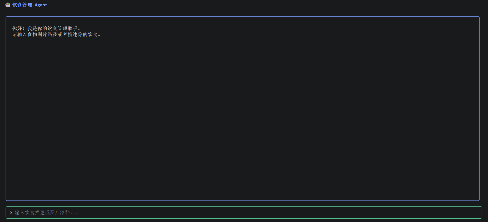
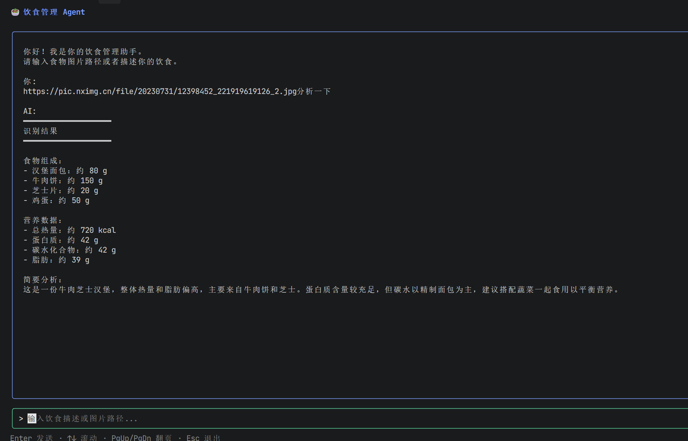
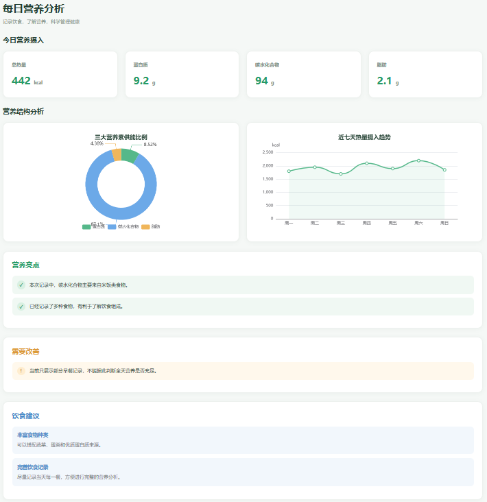

# 🥗 Picture Agent

<p align="center">
  <strong>基于 Go 开发的 AI 饮食管理助手</strong>
  <br/>
  结合多模态视觉识别、大语言模型与 Agent 工具调用，实现食物识别、营养分析和每日饮食记录。
</p>

<p align="center">
  
  
  
</p>

---

## 📖 项目简介

在日常饮食管理中，健身、增肌和减脂人群通常需要关注每日摄入的热量、蛋白质、脂肪和碳水化合物。

但在实际生活中，用户往往难以准确了解食物的营养成分。传统的饮食记录方式还需要手动查询食物信息、计算营养数据并填写记录，操作过程较为繁琐。

**Picture Agent** 是一个基于 Go 开发的 AI 饮食管理助手。项目结合视觉识别、大语言模型和 Agent 工具调用能力，用户可以通过自然语言与 Agent 交互，提供本地图片或网络图片，实现食物识别、营养成分估算、饮食记录和每日营养摄入统计。

## 📸 项目演示

### 1. Agent 对话界面

基于 Bubble Tea 构建终端交互界面，用户可以通过自然语言与 Agent 进行对话，并根据需求执行相应任务。



### 2. AI 食物识别

支持本地图片和网络图片输入，调用视觉模型识别食物，估算食物名称、重量以及热量、蛋白质、脂肪和碳水化合物等营养成分。



### 3. 每日营养统计

根据用户的饮食记录，查询指定日期的营养摄入情况，汇总每日总热量及主要营养成分。



## ✨ 核心功能

| 功能模块 | 功能说明 |
|---|---|
| AI 食物识别 | 支持本地图片和网络图片，识别食物信息 |
| 营养成分估算 | 估算食物重量、热量、蛋白质、脂肪和碳水化合物 |
| 饮食记录 | 保存食物信息、营养数据及用餐类型 |
| 营养数据查询 | 查询指定日期的饮食记录和营养摄入总量 |
| 自然语言交互 | 使用自然语言描述需求，无需手动选择固定操作流程 |
| Agent 工具调用 | 根据用户请求动态选择并执行相应工具 |

## 🛠️ 技术栈

| 技术 | 应用场景 |
|---|---|
| Go | 项目核心开发语言 |
| OpenAI Go SDK | 大模型 API 接入及 Responses API 调用 |
| DeepSeek | Agent 意图理解、任务分析与工具调用 |
| Qwen Vision | 食物图片识别与营养信息估算 |
| MySQL | 饮食记录持久化存储 |
| Bubble Tea | 终端交互界面构建 |
| Lip Gloss | 终端 UI 样式与布局美化 |

## 🏗️ Agent 工作流程

项目采用 Agent + Tools 的设计模式，将大语言模型的决策能力与具体业务工具相结合。

用户发起请求后，Agent 将请求交给大语言模型进行分析，根据任务需求选择相应工具。工具执行完成后，将结果返回给 Agent，由模型整理并生成最终回复。

```text
              用户
               |
               v
        Bubble Tea 终端界面
               |
               v
           Agent 核心
               |
               v
          DeepSeek 模型
               |
          工具选择与调用
               |
       +-------+-------+
       |       |       |
       v       v       v
   食物识别  营养查询  饮食记录
       |       |       |
       v       v       v
   Qwen Vision MySQL  MySQL
       |       |       |
       +-------+-------+
               |
               v
          返回工具结果
               |
               v
          模型整理回答
               |
               v
             用户
```

## 🔧 Agent Tools

目前 Agent 提供以下工具：

| 工具名称 | 功能 |
|---|---|
| `food_recognition` | 根据图片识别食物并估算营养成分 |
| `nutrition_query` | 查询指定日期的营养摄入统计 |
| `daily_record` | 保存每日饮食记录 |
| `get_current_time` | 获取当前日期及用餐类型 |

Agent 根据用户的实际需求选择合适的工具，并将工具执行结果作为后续回答的依据。

## 📂 项目目录结构

```text
picture_agent/
├── tools/                    # Agent 工具定义与实现
│   ├── tool.go               # ToolDef 基础结构与调用逻辑
│   ├── current_time.go       # 获取当前日期时间
│   ├── food_analysis.go      # 食物图片识别（调用视觉模型）
│   ├── daily_record.go       # 保存饮食记录到数据库
│   └── nutrition_query.go    # 查询指定日期营养数据（明细+汇总+近7天）
├── core/                     # 核心数据模型
│   └── session.go            # Agent 会话消息管理
├── databases/                # 数据库相关逻辑
│   └── mysql.go              # MySQL 连接初始化
├── config/                   # 配置管理
│   └── mcp.json              # MCP Server 启动配置
├── mcp/                      # MCP Client 模块
│   ├── config.go             # 读取解析 mcp.json 配置
│   ├── client.go             # MCP Client 创建、连接、关闭
│   ├── manager.go            # 多 MCP Server 生命周期管理
│   └── discovery.go          # 工具发现与 ToolDef 转换
├── mcp_server/               # MCP Server（报告生成服务）
│   ├── main.go               # stdio Server 启动与工具注册
│   └── report.go             # HTML 报告生成逻辑
├── web/                      # 营养分析网页模板
│   ├── index.html            # 报告页面结构
│   ├── css/style.css         # 页面样式
│   ├── js/nutrition.js       # 数据渲染与图表逻辑
│   └── assets/echarts.min.js # 离线 ECharts 图表库
├── reports/                  # 生成的营养分析报告（运行时产出）
│   └── nutrition-日期-时间戳/
│       ├── index.html
│       ├── css/style.css
│       ├── js/nutrition.js
│       └── assets/echarts.min.js
├── docs/
│   └── images/               # 项目截图
│       ├── agent.png
│       ├── food-recognition.png
│       └── nutrition-statistics.png
├── agent.go                  # Agent 核心逻辑（LLM 调用、工具编排、MCP 工具注册）
├── main.go                   # 程序入口（初始化客户端、数据库、MCP、TUI）
├── tui.go                    # Bubble Tea 终端交互界面
├── go.mod
└── go.sum
```

> 以上目录为结构示意，请根据项目实际代码进行调整。

## ⚙️ 环境准备

运行项目前，需要准备以下环境：

- Go
- MySQL 8.0+
- DeepSeek API Key
- Qwen Vision API Key

## 🚀 项目运行

### 1. 克隆项目

```bash
git clone <你的 GitHub 仓库地址>
cd picture_agent
```

### 2. 配置环境变量

在项目根目录创建 `.env` 文件，根据实际代码配置模型 API Key 和数据库连接信息。

```env
DEEPSEEK_API_KEY=your_deepseek_api_key
QWEN_API_KEY=your_qwen_api_key
MYSQL_DSN=your_mysql_dsn
```

请勿将包含真实密钥和密码的 `.env` 文件提交到 GitHub。

### 3. 安装依赖

```bash
go mod tidy
```

### 4. 初始化数据库

创建 MySQL 数据库，并根据项目实际提供的 SQL 脚本创建所需数据表。

### 5. 启动项目

```bash
go run .
```

## 🔮 后续规划

- [ ] 接入 MCP，扩展 Agent 的外部工具调用能力。
- [ ] 完善用户管理与个人营养目标设置。
- [ ] 增加历史饮食数据分析。
- [ ] 增加营养摄入趋势可视化。
- [ ] 优化食物识别和营养估算准确性。
- [ ] 增加个性化营养建议。

## 📄 License

本项目暂未指定开源协议。
